<p align="center">
  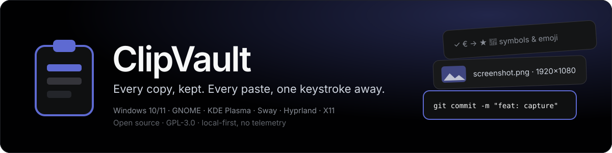
</p>

<p align="center">
  <a href="LICENSE"></a>
  <a href="https://github.com/Festo-Wampamba/clipvault/actions/workflows/ci.yml"></a>
  
  
  <a href="CONTRIBUTING.md"></a>
</p>

**ClipVault** is a free, open-source clipboard manager for **Windows 10/11** and **Linux (Wayland and X11)**.
It combines the power-user depth of [Ditto](https://github.com/sabrogden/Ditto) (Windows) with the
clean, keyboard-first panel experience of
[GNOME Clipboard Indicator](https://github.com/Tudmotu/gnome-shell-extension-clipboard-indicator) (Linux),
in one cross-platform app that is **local-first, private by default, and fully under your control**.

> [!NOTE]
> **Project status: design phase.** This README is the engineering design document. Code starts with the
> [MVP milestone](#17-roadmap). Contributors are very welcome — see [CONTRIBUTING.md](CONTRIBUTING.md).

---

## Table of contents

1. [Vision](#1-vision)
2. [Feature set — Ditto + GNOME Clipboard Indicator, combined](#2-feature-set)
3. [Supported platforms](#3-supported-platforms)
4. [Architecture overview](#4-architecture-overview)
5. [Clipboard capture backends](#5-clipboard-capture-backends)
6. [Runtime flows](#6-runtime-flows)
7. [Capture pipeline](#7-capture-pipeline)
8. [Data model and storage](#8-data-model-and-storage)
9. [User interface](#9-user-interface)
10. [Security and privacy](#10-security-and-privacy)
11. [Device sync (Phase 4)](#11-device-sync-phase-4)
12. [Technology stack](#12-technology-stack)
13. [Repository layout](#13-repository-layout)
14. [Development setup](#14-development-setup)
15. [CI/CD pipeline](#15-cicd-pipeline)
16. [Packaging and distribution](#16-packaging-and-distribution)
17. [Roadmap](#17-roadmap)
18. [Risks](#18-risks)
19. [Contributing](#19-contributing)
20. [License](#20-license)

---

## 1. Vision

Every time you copy something — a sentence, a screenshot, a link, an emoji, a file — ClipVault keeps it.
Press one hotkey, type a few letters, hit <kbd>Enter</kbd>, and it is pasted back where you were working.

| Principle | What it means in practice |
|---|---|
| **Local-first** | History lives in a SQLite database on your machine. No account, no cloud, no telemetry. |
| **Everything is captured** | Text, Unicode symbols and emoji, images, HTML, RTF, and file lists — every format of a copy is kept. |
| **Keyboard-first** | Hotkey → search → <kbd>Enter</kbd>. Quick-paste slots <kbd>Ctrl</kbd>+<kbd>1</kbd>…<kbd>9</kbd>. Mouse optional. |
| **Private by default** | Password-manager copies are skipped, apps can be excluded, private mode pauses capture. |
| **One app, every desktop** | Same features on Windows, GNOME, KDE Plasma, Sway, Hyprland, and legacy X11. |
| **You own it** | GPL-3.0. Self-hostable sync relay. Your data, your server, your rules. |

---

## 2. Feature set

ClipVault takes the best of both reference apps:

| Feature | Ditto | GNOME Clipboard Indicator | **ClipVault** | Milestone |
|---|:---:|:---:|:---:|:---:|
| Text history | ✅ | ✅ | ✅ | MVP |
| Images | ✅ | ✅ | ✅ with thumbnails | MVP |
| HTML / RTF / custom formats | ✅ | — | ✅ | MVP |
| Copied files (file lists) | ✅ | — | ✅ | MVP |
| Deduplicate (re-copy moves item to top) | ✅ | ✅ | ✅ | MVP |
| Global hotkey popup | ✅ | ✅ | ✅ | MVP |
| Tray / top-bar indicator | ✅ | ✅ | ✅ | MVP |
| Full-text search | ✅ | ✅ | ✅ (SQLite FTS5) | MVP |
| Regex search | — | ✅ | ✅ | MVP |
| Paste into previous window | ✅ | ✅ | ✅ | MVP |
| Paste as plain text | ✅ | — | ✅ | MVP |
| Quick-paste by position (1–9) | ✅ | — | ✅ | MVP |
| Pin / favourite items | ✅ (sticky) | ✅ | ✅ | MVP |
| Private mode (pause capture) | — | ✅ | ✅ | MVP |
| Exclude apps (e.g. password managers) | ✅ | ✅ | ✅ | MVP |
| Respect "sensitive content" hints | partial | — | ✅ | MVP |
| History limits (count / age / size) + auto-clear | ✅ | ✅ | ✅ | MVP |
| Terminal-aware paste | — | ✅ | ✅ | MVP |
| Groups / folders | ✅ | — | ✅ | v0.2 |
| Tags | — | ✅ | ✅ | v0.2 |
| Edit entries | ✅ | ✅ | ✅ | v0.2 |
| Multi-select paste | ✅ | — | ✅ | v0.2 |
| Text transforms (trim, case, strip formatting) | ✅ (scripts) | — | ✅ | v0.2 |
| Encrypted history at rest | — | — | ✅ (OS keyring) | v0.2 |
| Export / import | ✅ | — | ✅ | v0.2 |
| LAN sync between your devices | ✅ (send to friends) | — | ✅ end-to-end encrypted | v0.3 |
| Self-hosted relay sync | — | — | ✅ end-to-end encrypted | v0.3 |
| Portable mode (Windows) | ✅ | — | ✅ | v1.0 |
| Windows **and** Linux | — | — | ✅ | MVP |

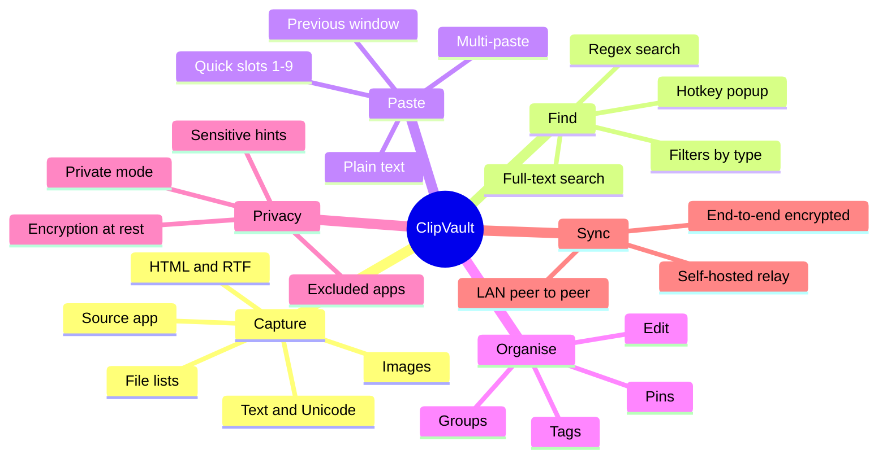

---

## 3. Supported platforms

| Platform | Session | Capture mechanism | Paste-back mechanism | Global hotkey | Status |
|---|---|---|---|---|---|
| **Windows 11 / 10** | Win32 | `AddClipboardFormatListener` → `WM_CLIPBOARDUPDATE` | `SendInput` (<kbd>Ctrl</kbd>+<kbd>V</kbd>) | `RegisterHotKey` | MVP |
| **GNOME** (Ubuntu, Fedora…) | Wayland | ClipVault **GNOME Shell extension** → D-Bus | Extension virtual keyboard | Extension keybinding | MVP |
| **KDE Plasma 6** | Wayland | `ext-data-control-v1` | XDG RemoteDesktop portal (libei) | XDG GlobalShortcuts portal | MVP |
| **Sway / river / other wlroots** | Wayland | `ext-data-control-v1` or `zwlr-data-control-v1` | `virtual-keyboard-unstable-v1` | Compositor bind → `clipvault toggle` | MVP |
| **Hyprland** | Wayland | `ext-data-control-v1` or `zwlr-data-control-v1` | `virtual-keyboard-unstable-v1` | GlobalShortcuts portal or `bind` → `clipvault toggle` | MVP |
| **Any desktop on Xorg** (legacy) | X11 | XFixes `SelectionNotify` | XTest | `XGrabKey` | MVP |
| **macOS** | — | `NSPasteboard.changeCount` polling | `CGEvent` | Carbon hotkey | Later |

> [!IMPORTANT]
> **Why GNOME needs an extension.** GNOME's compositor (Mutter) does not implement the Wayland
> *data-control* protocols, so no ordinary app can observe the clipboard in the background on GNOME
> Wayland. This is a deliberate security design, and it is the reason GNOME Clipboard Indicator itself
> runs *inside* GNOME Shell. ClipVault ships a small, auditable GNOME Shell extension that forwards
> clipboard events to the ClipVault app over D-Bus. On every other Wayland compositor the app talks to
> the compositor directly.

**About Xorg:** GNOME and Ubuntu have dropped the Xorg session from their defaults, and KDE is moving the
same way, so Wayland is the primary Linux target. The X11 backend is kept for users on older releases and
for distributions that still ship Xorg — it is small and cheap to maintain.

---

## 4. Architecture overview

<p align="center">
  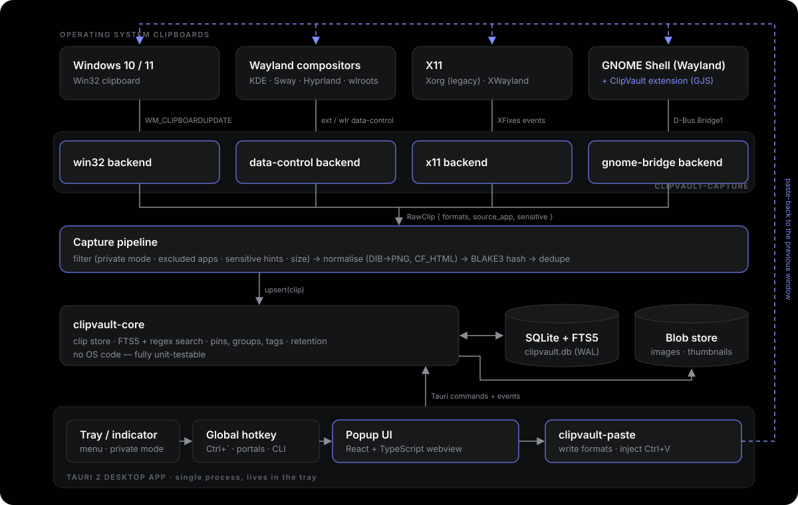
</p>

ClipVault is **one Rust process** (a Tauri 2 tray app) plus, on GNOME only, **one GJS shell extension**.
There is no background server: the tray app *is* the daemon, and the popup window is a hidden webview
that is shown on the hotkey.

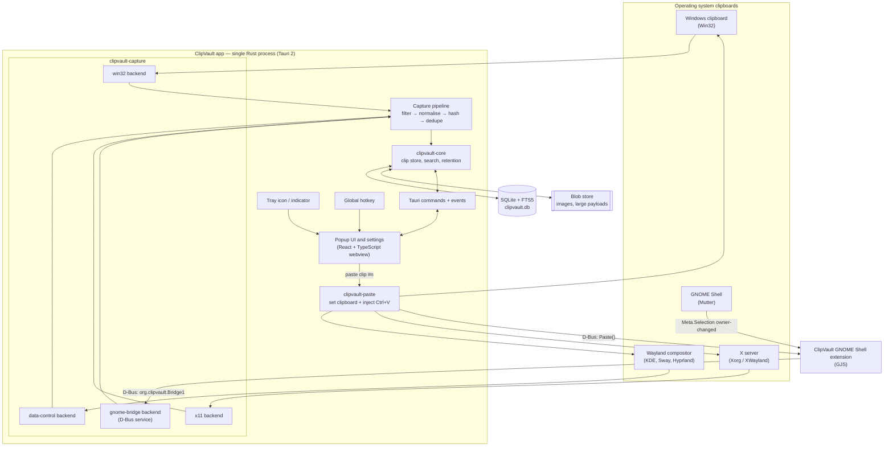

### Components

| Component | Language | Responsibility |
|---|---|---|
| `clipvault-core` | Rust | Clip model, SQLite schema and migrations, full-text search, dedupe, retention, settings. No OS code. |
| `clipvault-capture` | Rust | One `ClipboardBackend` implementation per platform, chosen at runtime. Emits `RawClip` events. |
| `clipvault-paste` | Rust | Writes a clip back to the clipboard (all formats) and injects the paste keystroke into the previous window. |
| `apps/desktop` | Rust + TypeScript | Tauri 2 shell: tray, hotkey, window management, commands bridge, React UI. |
| `extensions/gnome-shell` | JavaScript (GJS) | GNOME only: watches the selection, reads all MIME types, forwards over D-Bus, performs paste, adds a top-bar indicator. |
| `apps/relay` (v0.3) | Rust | Optional self-hosted sync relay that stores only end-to-end-encrypted blobs. |

---

## 5. Clipboard capture backends

At start-up the app inspects the session and picks exactly one backend:

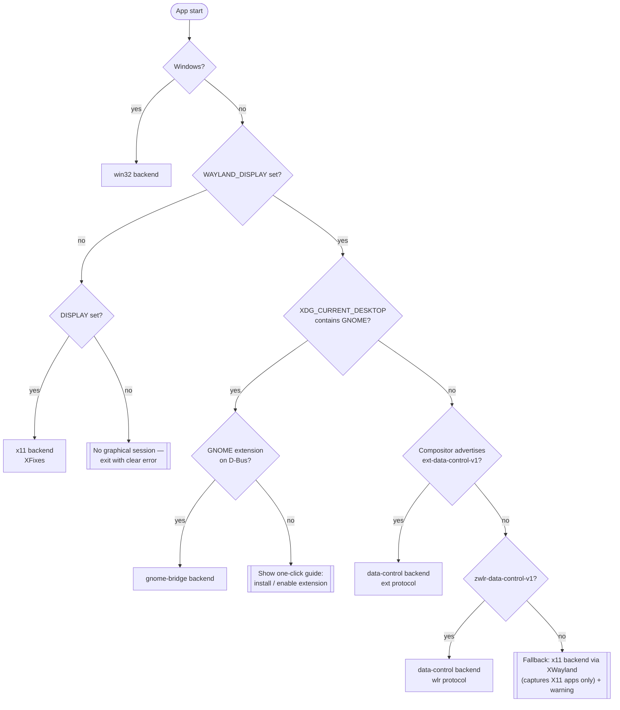

All backends implement one small trait, so the rest of the app never knows which OS it is on:

```rust
/// Implemented once per platform. Lives in crates/clipvault-capture.
pub trait ClipboardBackend: Send {
    /// Start watching; every clipboard change is sent as a RawClip.
    fn watch(&mut self, tx: Sender<RawClip>) -> Result<()>;
    /// Put a clip (all of its formats) on the system clipboard.
    fn write(&mut self, clip: &ClipPayload) -> Result<()>;
}

pub struct RawClip {
    pub formats: Vec<(Mime, Bytes)>,   // e.g. text/plain, text/html, image/png
    pub source_app: Option<String>,    // process / window / app-id when the OS exposes it
    pub sensitive: bool,               // password-manager hint detected
}
```

### Format mapping

| ClipVault MIME | Windows clipboard format | Wayland / X11 MIME |
|---|---|---|
| `text/plain;charset=utf-8` | `CF_UNICODETEXT` | `text/plain;charset=utf-8`, `UTF8_STRING` |
| `text/html` | `HTML Format` (CF_HTML header stripped) | `text/html` |
| `text/rtf` | `Rich Text Format` | `text/rtf`, `application/rtf` |
| `image/png` | `PNG`, else `CF_DIBV5` / `CF_DIB` → encoded to PNG | `image/png` (others converted) |
| `text/uri-list` | `CF_HDROP` | `text/uri-list`, `x-special/gnome-copied-files` |
| *sensitive hint* | `ExcludeClipboardContentFromMonitorProcessing`, `CanIncludeInClipboardHistory = 0` | `x-kde-passwordManagerHint = secret` |

Symbols and emoji are plain UTF-8 text and need no special handling — the store is UTF-8 end to end.

---

## 6. Runtime flows

### 6.1 Capturing a copy

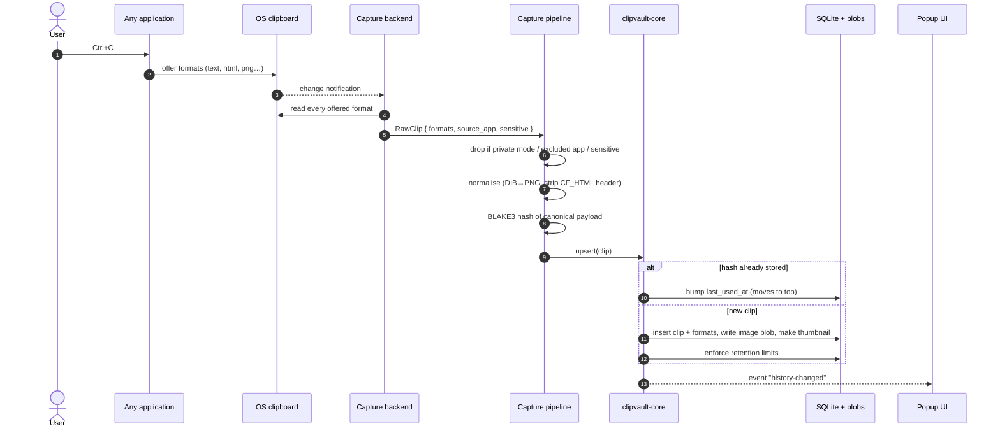

### 6.2 Recalling and pasting

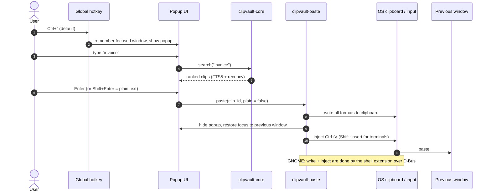

---

## 7. Capture pipeline

Every clip passes through the same pipeline, regardless of platform:

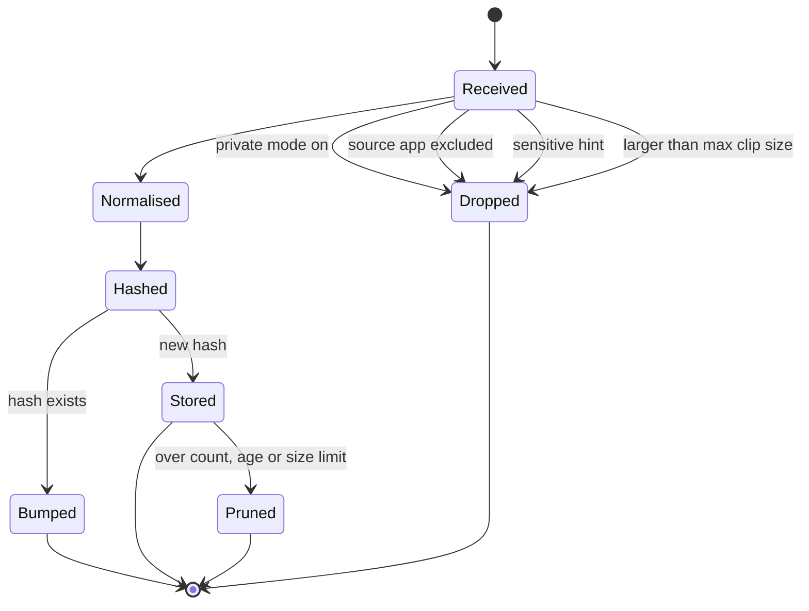

| Setting | Default | Notes |
|---|---|---|
| Max history items | 500 | Pinned items never count toward the limit. |
| Max age | 30 days | `0` = keep forever. |
| Max single clip size | 20 MB | Larger copies are skipped with a tray notice. |
| Max total storage | 1 GB | Oldest unpinned blobs are pruned first. |
| Clear on start-up | off | Clipboard Indicator's "clear at boot". |
| Private mode | off | Toggle from tray, popup, or `clipvault private on`. |

---

## 8. Data model and storage

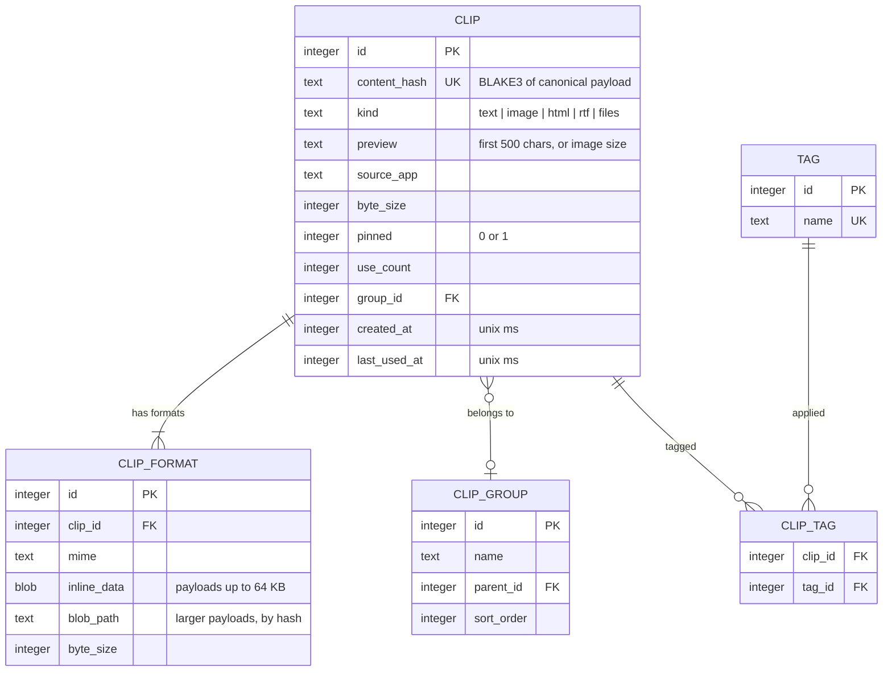

Plus a `clip_fts` FTS5 virtual table over `preview` and full text, a `setting` key/value table, and an
`excluded_app` table. Schema changes ship as numbered SQL migrations.

### On-disk layout

| OS | Location |
|---|---|
| Linux | `$XDG_DATA_HOME/clipvault/` (default `~/.local/share/clipvault/`) |
| Windows | `%APPDATA%\ClipVault\` (or next to the `.exe` in portable mode) |

```text
clipvault/
├── clipvault.db            # SQLite (WAL mode)
├── blobs/ab/abcdef….png    # content-addressed by BLAKE3 hash
└── thumbs/ab/abcdef….webp  # 256 px thumbnails for the list
```

---

## 9. User interface

### 9.1 Hotkey popup

<p align="center">
  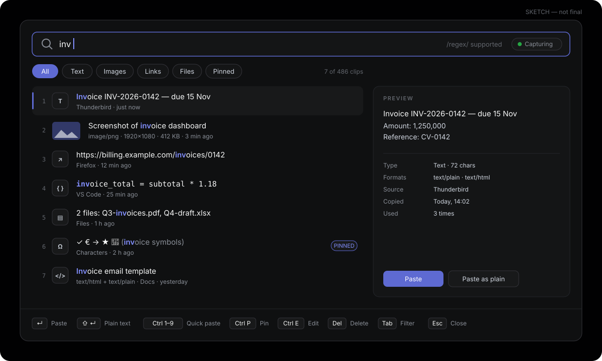
</p>

### 9.2 GNOME top-bar indicator

<p align="center">
  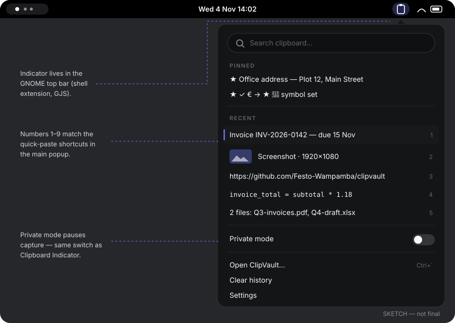
</p>

The UI follows a dark-canvas design system (near-black canvas, light-grey text, a single lavender-blue
accent `#5e6ad2`) with a light theme that follows the OS setting.

### 9.3 Keyboard shortcuts

| Action | Default shortcut |
|---|---|
| Open / close popup | <kbd>Ctrl</kbd>+<kbd>`</kbd> (configurable) |
| Navigate | <kbd>↑</kbd> <kbd>↓</kbd>, <kbd>PgUp</kbd> <kbd>PgDn</kbd>, <kbd>Home</kbd> <kbd>End</kbd> |
| Paste selected | <kbd>Enter</kbd> or double-click |
| Paste as plain text | <kbd>Shift</kbd>+<kbd>Enter</kbd> |
| Quick-paste item 1–9 | <kbd>Ctrl</kbd>+<kbd>1</kbd> … <kbd>Ctrl</kbd>+<kbd>9</kbd> |
| Pin / unpin | <kbd>Ctrl</kbd>+<kbd>P</kbd> |
| Edit | <kbd>Ctrl</kbd>+<kbd>E</kbd> |
| Tag | <kbd>Ctrl</kbd>+<kbd>T</kbd> |
| Delete | <kbd>Del</kbd> |
| Filter by type | <kbd>Tab</kbd> cycles All → Text → Images → Links → Files → Pinned |
| Regex search | Wrap the query in slashes: `/inv-\d+/` |
| Toggle private mode | <kbd>Ctrl</kbd>+<kbd>Shift</kbd>+<kbd>P</kbd> |

### 9.4 Command line

The same binary doubles as a small CLI, which is also how Sway and Hyprland users bind the hotkey:

```bash
clipvault toggle           # show / hide the popup
clipvault private on|off   # pause / resume capture
clipvault clear            # clear unpinned history
clipvault list --limit 10  # print recent text clips
```

---

## 10. Security and privacy

A clipboard manager sees passwords, tokens, and personal data. ClipVault treats that seriously.

| Threat | Mitigation |
|---|---|
| Password-manager copies stored in history | Honour the Windows exclusion formats and the `x-kde-passwordManagerHint` MIME type; ship a default excluded-apps list (KeePassXC, Bitwarden, 1Password…). |
| Someone reads `clipvault.db` from disk | Optional encryption at rest (SQLCipher) with the key in the OS keyring (Windows Credential Manager, Secret Service). |
| Clipboard data leaving the machine | No network code in the MVP. Sync (v0.3) is opt-in and end-to-end encrypted — the relay only stores ciphertext. |
| Malicious D-Bus caller on Linux | The bridge interface only accepts calls from the session bus; the extension and app verify each other's well-known names. |
| Shell freeze on huge images (known Clipboard Indicator issue) | The extension passes large payloads through a temporary file descriptor, not inline D-Bus messages, and never decodes images in the shell. |
| Supply-chain risk | `cargo deny` and `cargo audit` in CI, Dependabot updates, signed release artifacts. |
| Telemetry | None. Not now, not later. |

Report vulnerabilities privately — see [SECURITY.md](SECURITY.md).

---

## 11. Device sync (Phase 4)

Sync is **optional** and arrives after the MVP. ClipVault never needs a server to work.

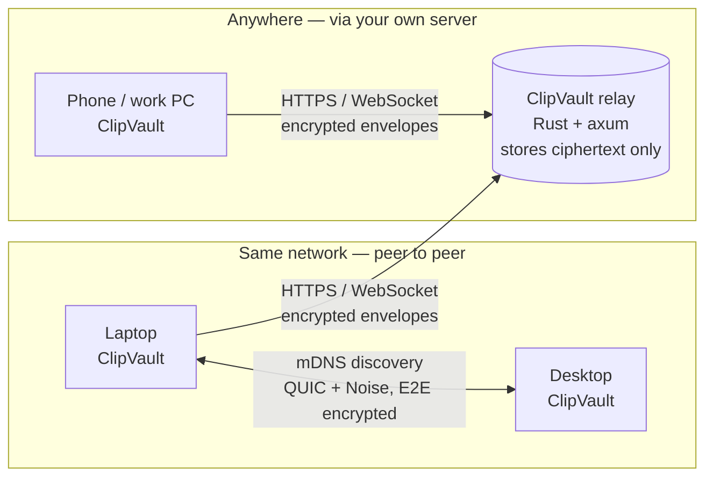

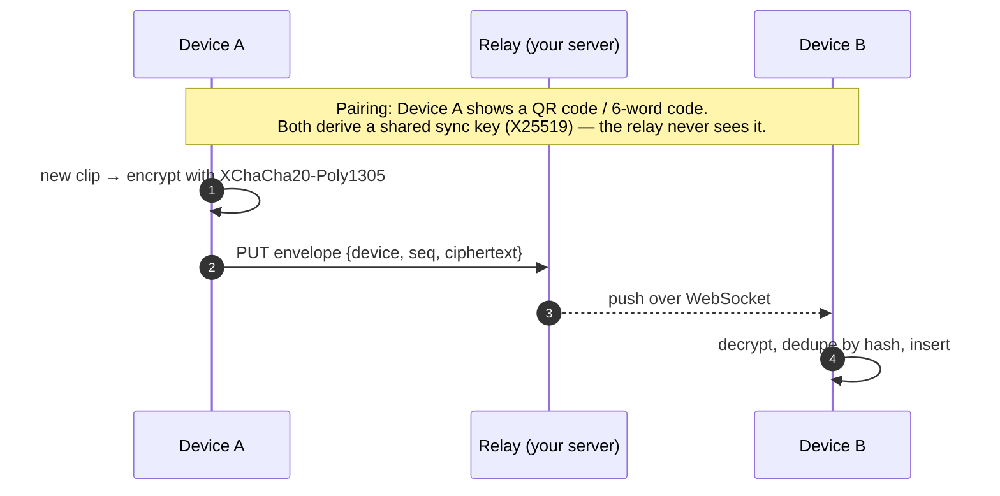

**Relay deployment (your server):** a single static Rust binary, or Docker Compose, behind Caddy for
automatic HTTPS, on Ubuntu 24.04. Storage is SQLite (or PostgreSQL for many users). Envelopes expire
after a configurable time.

---

## 12. Technology stack

### Languages

| Language | Where | Why |
|---|---|---|
| **Rust** (stable, edition 2024) | Core, capture, paste, Tauri back end, relay | Memory-safe, fast, tiny always-on footprint, first-class Win32 / Wayland / X11 / D-Bus crates. |
| **TypeScript** | Popup and settings UI | Fast iteration on a rich, searchable UI. |
| **JavaScript (GJS)** | GNOME Shell extension | The only language GNOME Shell extensions can be written in. |
| **SQL** | Schema and migrations | SQLite with FTS5. |

### Frameworks, libraries, and tools

| Area | Choice |
|---|---|
| App shell | [Tauri 2](https://tauri.app) — tray, windows, installers, updater |
| Tauri plugins | `global-shortcut`, `single-instance`, `autostart`, `updater`, `notification` |
| UI | React 19 + TypeScript + Vite, built with **pnpm** |
| Windows APIs | [`windows`](https://crates.io/crates/windows) crate (clipboard listener, `SendInput`, `RegisterHotKey`) |
| Wayland | `wayland-client` + `wayland-protocols` (ext / wlr data-control, virtual keyboard), [`wl-clipboard-rs`](https://crates.io/crates/wl-clipboard-rs) |
| X11 | [`x11rb`](https://crates.io/crates/x11rb) (XFixes, XTest) |
| D-Bus / portals | [`zbus`](https://crates.io/crates/zbus), [`ashpd`](https://crates.io/crates/ashpd) (GlobalShortcuts, RemoteDesktop portals) |
| Storage | [`rusqlite`](https://crates.io/crates/rusqlite) (bundled SQLite, FTS5; SQLCipher for encryption at rest) |
| Hashing | [`blake3`](https://crates.io/crates/blake3) |
| Images | [`image`](https://crates.io/crates/image) (DIB → PNG, thumbnails) |
| Async / logging | `tokio`, `tracing` |
| Secrets | [`keyring`](https://crates.io/crates/keyring) |
| Sync (v0.3) | `quinn` (QUIC), `snow` (Noise), `chacha20poly1305`, `mdns-sd`, `axum` (relay) |
| Testing | `cargo test`, `insta` snapshots, Vitest (UI), headless Sway and Xvfb in CI for backend integration tests |
| Quality | `rustfmt`, `clippy -D warnings`, `cargo deny`, ESLint, Prettier, markdownlint |
| CI/CD | GitHub Actions (unlimited free minutes for public repositories), `tauri-action` for releases |

### Why Rust + Tauri — and what was rejected

| Option | Verdict |
|---|---|
| **Rust + Tauri 2** | ✅ **Chosen.** ~10 MB installer, low idle memory, native OS APIs in Rust, modern web UI, built-in installer and updater tooling. |
| C++ + Qt (the CopyQ approach) | Mature and native, but slower to develop, harder for new contributors, heavier licensing and build setup. |
| C++ + MFC (the Ditto approach) | Windows-only. |
| Electron | ~150 MB and hundreds of MB of RAM for an app that runs all day. Too heavy. |
| Python + Qt | Packaging pain and slow image handling. |
| Flutter | Weak tray, global-hotkey, and Wayland clipboard support on desktop. |

---

## 13. Repository layout

Planned structure (created as each milestone lands):

```text
clipvault/
├── Cargo.toml                    # Rust workspace
├── crates/
│   ├── clipvault-core/           # model, storage, search, retention (no OS code)
│   ├── clipvault-capture/        # ClipboardBackend trait + win32 / data-control / x11 / gnome-bridge
│   └── clipvault-paste/          # write-back + keystroke injection
├── apps/
│   ├── desktop/                  # Tauri 2 app
│   │   ├── src-tauri/            # Rust: tray, hotkey, commands
│   │   └── src/                  # React + TypeScript UI
│   └── relay/                    # v0.3: self-hosted sync relay
├── extensions/
│   └── gnome-shell/              # clipvault@festo-wampamba.github.io (GJS)
├── docs/
│   └── images/                   # diagrams and UI sketches
└── .github/                      # CI/CD workflows, issue and PR templates
```

---

## 14. Development setup

### Prerequisites

| Tool | Version | Install |
|---|---|---|
| Rust | stable | `curl https://sh.rustup.rs -sSf \| sh` |
| Node.js | 20 or newer | [nodejs.org](https://nodejs.org) or `nvm` |
| pnpm | 9 or newer | `corepack enable` |
| Tauri CLI | 2.x | `cargo install tauri-cli --version "^2"` |

**Ubuntu 24.04 / Debian:**

```bash
sudo apt install build-essential pkg-config libssl-dev libwebkit2gtk-4.1-dev \
  libayatana-appindicator3-dev librsvg2-dev libxdo-dev libxcb-xfixes0-dev
```

**Fedora:**

```bash
sudo dnf install webkit2gtk4.1-devel openssl-devel libappindicator-gtk3-devel librsvg2-devel libxdo-devel
```

**Windows 10/11:** install the
[Visual Studio Build Tools](https://visualstudio.microsoft.com/visual-cpp-build-tools/) with the
*Desktop development with C++* workload. WebView2 is built into Windows 11 (installer bootstraps it on 10).

**GNOME extension development:** GNOME 46 or newer (Ubuntu 24.04 ships 46). Nested shell for testing:
`dbus-run-session -- gnome-shell --nested --wayland` (GNOME 46–48) or `gnome-shell --devkit` (GNOME 49+).

### Build and run (once the MVP code lands)

```bash
git clone https://github.com/Festo-Wampamba/clipvault.git
cd clipvault
pnpm install
cargo tauri dev        # run the app with hot reload
cargo test --workspace # run all Rust tests
```

---

## 15. CI/CD pipeline

GitHub Actions is free and unlimited for public repositories, on Linux, Windows, and macOS runners.

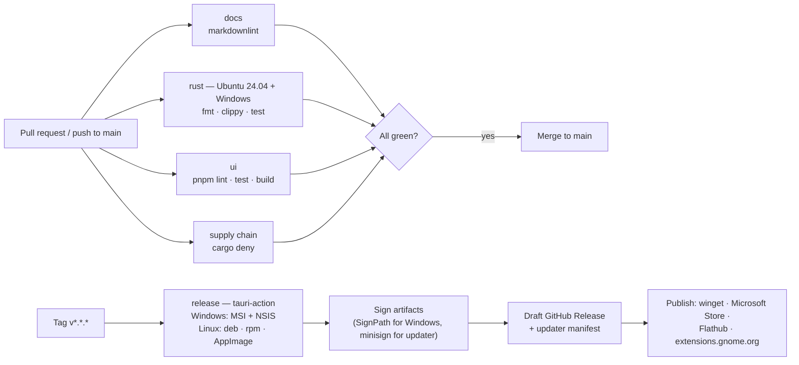

| Workflow | Trigger | Jobs |
|---|---|---|
| [`ci.yml`](.github/workflows/ci.yml) | Push to `main`, every PR | Markdown lint; Rust fmt / clippy / test on Ubuntu 24.04 and Windows; UI lint / test / build. Code jobs switch on automatically once `Cargo.toml` / `package.json` exist. |
| [`release.yml`](.github/workflows/release.yml) | Tag `v*.*.*` | Build installers on Ubuntu and Windows with `tauri-action`, attach to a draft GitHub Release. |
| [`dependabot.yml`](.github/dependabot.yml) | Weekly | Keeps GitHub Actions versions current (Cargo and npm added when manifests exist). |

---

## 16. Packaging and distribution

| Channel | Format | Notes |
|---|---|---|
| GitHub Releases | `.msi`, `.exe` (NSIS), `.deb`, `.rpm`, `.AppImage` | Primary channel; auto-updater reads the signed manifest. |
| winget | Manifest PR to `microsoft/winget-pkgs` | `winget install ClipVault.ClipVault` |
| Microsoft Store | MSIX | Optional. |
| Flathub | Flatpak | Clipboard access inside the sandbox needs care; ship after `.deb` / AppImage. |
| extensions.gnome.org | Zip | Required for GNOME users; reviewed by GNOME. |
| AUR | `PKGBUILD` | Community-maintained. |

**Code signing:** Windows builds are signed for free through [SignPath Foundation](https://signpath.org)
(open-source program, the same route Ditto uses); updater bundles are signed with Tauri's minisign key.

---

## 17. Roadmap

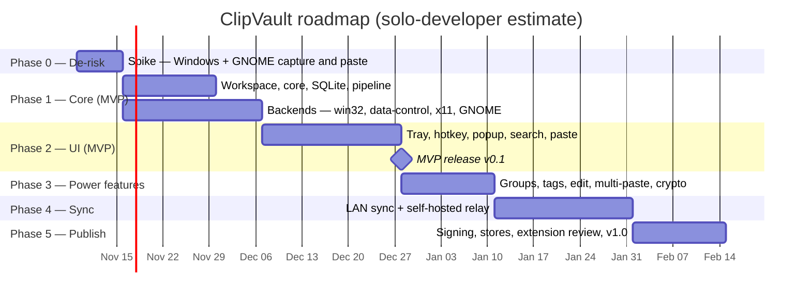

### Milestones

- [ ] **Phase 0 — De-risk:** prove text + image capture and paste-back on Windows 11 and on GNOME Wayland via a prototype extension.
- [ ] **v0.1 MVP:** everything marked *MVP* in the [feature table](#2-feature-set), on every platform in [§3](#3-supported-platforms).
- [ ] **v0.2:** groups, tags, editing, multi-paste, transforms, encryption at rest, export / import.
- [ ] **v0.3:** LAN sync and self-hosted relay.
- [ ] **v1.0:** signed installers in every channel, GNOME extension published, portable mode, docs site.

---

## 18. Risks

| Risk | Level | Mitigation |
|---|---|---|
| GNOME Wayland blocks background clipboard access | **High** | Companion shell extension; proven first in Phase 0. |
| Sensitive data stored in history | **High** | Sensitive hints, excluded apps, private mode, optional encryption. |
| Keystroke injection limited on Wayland | Medium | Per-compositor injection (virtual keyboard, RemoteDesktop portal, GNOME extension); fallback = copy + notify "press Ctrl+V". |
| Antivirus false positives (clipboard + keystroke app) | Medium | Code signing, standard APIs only, reproducible builds. |
| Large images cause lag | Medium | Size cap, off-thread encoding, thumbnails, FD passing on GNOME. |
| Flatpak sandbox clipboard limits | Medium | `.deb` / `.rpm` / AppImage first. |
| GNOME extension review delays | Low | Keep the extension small, readable, and dependency-free. |
| GPL code reuse confusion | Low | Ditto and Clipboard Indicator are studied for features only; ClipVault is written from scratch. |

---

## 19. Contributing

ClipVault is built in the open and welcomes contributors of every level — Rust, TypeScript, GJS, design,
docs, packaging, and testing on your desktop. Start with [CONTRIBUTING.md](CONTRIBUTING.md) and the
issues labelled **good first issue**. Please follow the [Code of Conduct](CODE_OF_CONDUCT.md).

## 20. License

ClipVault is free software, licensed under the [GNU General Public License v3.0](LICENSE).
You may use, study, share, and modify it; distributed modified versions must remain under the GPL-3.0.

*Inspired by, but not derived from, [Ditto](https://github.com/sabrogden/Ditto) and
[GNOME Clipboard Indicator](https://github.com/Tudmotu/gnome-shell-extension-clipboard-indicator).*
